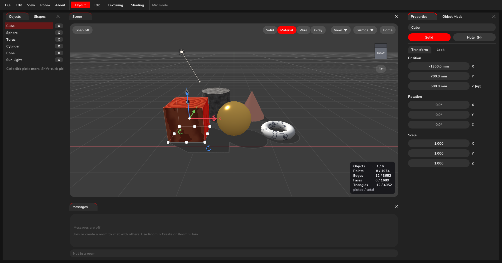
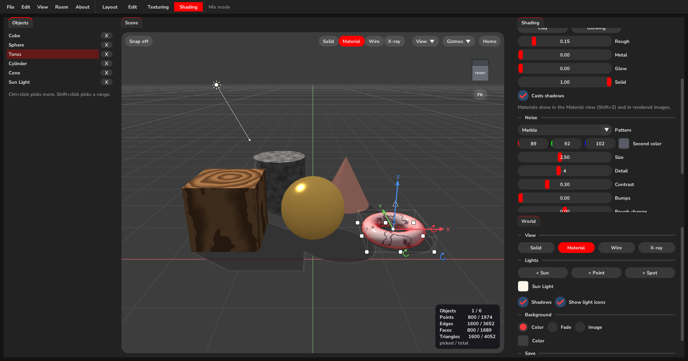
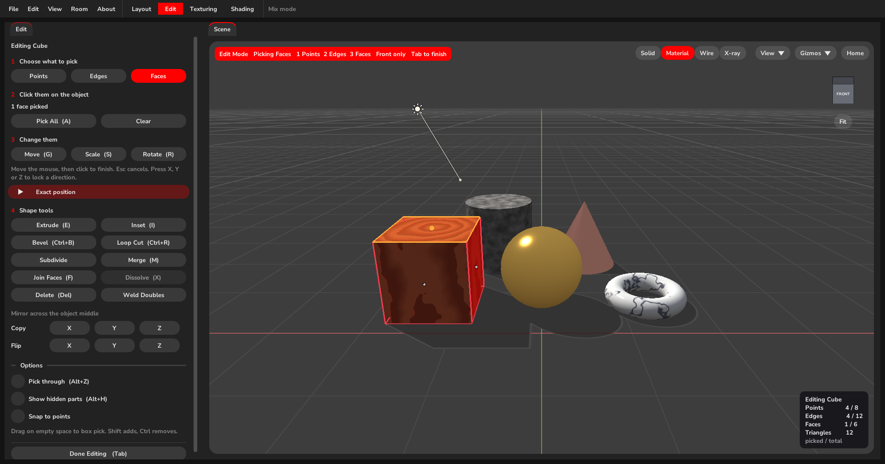
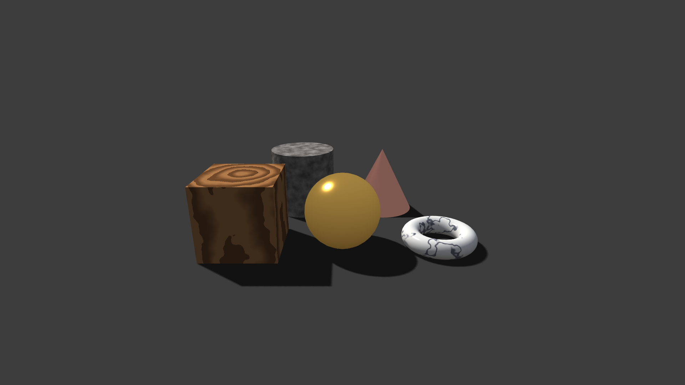

## RunBun Sandbox

A live 3D modeling sandbox built from scratch in C++ with OpenGL. Make shapes, reshape them in Edit Mode, give them materials, lights and noise patterns, render pictures, export to other 3D apps, and build together with friends in shared rooms over your network.

## Clarity (PLEASE READ)
- I did NOT make an early repo for this project. I wouldn't say it was very in depth before my first commit, but there was some decent progress done. I wasn't thinking at the time of making this a public project, but did manage to capture some early images of the UI and features. See the images below.

## Features

### Building
- Tinker mode (simple, Tinkercad style) and Mix mode (everything)
- 12 shapes: cube, sphere, cylinder, cone, capsule, torus, pyramid, plane, wedge, roof, half sphere and tube, plus holes that cut into shapes
- Move arrows, size handles, G / S / R keys, snapping in millimeters, align, mirror, drop to ground
- Group, ungroup and join (J), with holes cut out
- Object Mods that change a shape without touching the original: Boolean, Mirror, Array, Bevel, Smooth Subdivide, Solidify and Smooth, with Apply
- Right click quick menu, undo and redo, multi select, rename, statistics

### Edit Mode
- Pick points, edges or faces (1 / 2 / 3), box pick, pick through and show hidden parts options
- Extrude, inset, bevel, loop cut, subdivide, merge, join faces (F), fill, dissolve (X), delete, weld, mirror and flip

### Texturing
- Mark seams and unwrap (LSCM), with a UV editor
- Load images onto objects with repeat, offset and turn

### Shading
- Its own Shading tab (Ctrl+4)
- View styles: Solid, Material, Wire and X-ray (Shift+Z)
- Materials with roughness, metal, glow and see-through, plus presets like Gold, Glass, Wood, Marble and Stone
- Noise patterns: Perlin, Clouds, Marble, Wood, Cells and Stripes, with a second color, size, detail, contrast, bumps and seed
- Sun, point and spot lights shown as small icons, with shadows from the sun
- Backgrounds: color, fade or image

### Saving and Sharing
- Save and open scenes
- Render Image (F12) to PNG at any size, with an optional see-through background
- Export picked objects to GLB, glTF, FBX, OBJ, DAE, 3DS, X3D, X, PLY, STL, 3MF and STEP, with images put inside the file where the format allows
- Rooms: host or join with a room key and build the same scene together live. Room name, guest editing, people limit and lock. Two people can edit the same object as long as they pick different parts
- Chat, and a Console that logs every action, warning and error

### Interface
- Layout, Edit, Texturing and Shading tabs with docked or floating panels
- Themes and custom UI colors, full or minimal help text
- Orbit or fly camera

## Planned
- Auto retopology tool
- Voice chat between connected users

## Built With

| Library | Used for |
| --- | --- |
| C++ | The whole app |
| [OpenGL](https://www.opengl.org/) | Rendering the scene on the GPU, with custom GLSL shaders |
| [GLFW](https://www.glfw.org/) | Window, OpenGL context, and keyboard and mouse input |
| [GLAD](https://github.com/Dav1dde/glad) | Loading OpenGL functions at runtime |
| [GLM](https://github.com/g-truc/glm) | Vector and matrix math for transforms and the camera |
| [Dear ImGui](https://github.com/ocornut/imgui) | The editor UI and docking panels |
| [Assimp](https://github.com/assimp/assimp) | Importing models and exporting to many 3D formats |
| [stb_image](https://github.com/nothings/stb) | Loading PNG, JPG and BMP images |
| [zlib](https://zlib.net/) | Packing room data and writing PNG images |
| [tinyfiledialogs](https://sourceforge.net/projects/tinyfiledialogs/) | Open and save dialogs |
| [Rust](https://www.rust-lang.org/) and [rust-libp2p](https://github.com/libp2p/rust-libp2p) | Peer to peer rooms |

## Project Layout
```
src/            Sandbox source code
  core/         Camera, input, scene objects, saving, undo, UI settings
  render/       Shaders, meshes, shapes, mods, CSG, UV unwrap, export, scene renderer
  ui/           Panels, tabs, edit mode, shading, rooms sync, console, dialogs
  main.cpp
  RunBun.rc     App icon
assets/         Fonts, icons and GLSL shaders (copied next to the exe on build)
third_party/    Dear ImGui, GLAD, stb_image, tinyfiledialogs
networking/     Rust peer to peer rooms (rust-libp2p)
tests/          Geometry, docking and export tests
screenshots/    README screenshots
build.bat       Windows build script
```

## Building (Windows)
1. Install [MSYS2](https://www.msys2.org/) to `C:\msys64`
2. In an MSYS2 shell, install the toolchain and libraries:
   ```
   pacman -S mingw-w64-x86_64-gcc mingw-w64-ucrt-x86_64-assimp mingw-w64-ucrt-x86_64-glfw mingw-w64-ucrt-x86_64-glm mingw-w64-ucrt-x86_64-zlib
   ```
3. Install [Rust](https://rustup.rs/) and the GNU toolchain:
   ```
   rustup toolchain install stable-x86_64-pc-windows-gnu
   ```
4. Run `build.bat`. The app is built to `bin\RunBunSandbox.exe` along with its assets.

## Tests
- `tests\geometry\run.bat` for shapes, edit tools, CSG, mods and unwrapping
- `tests\docking\run.bat` for the panel layouts
- `tests\export\run.bat` for every export format
- `cargo test --release` in `networking` for rooms

## Current Build (11/08/26)

Layout tab in Mix mode with materials, a sun light and shadows.



Shading tab with the marble noise settings on the torus.



Edit tab with the top face of the cube picked.



A Full HD picture made with Render Image.


