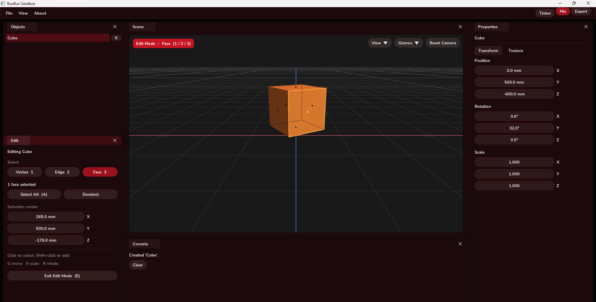

## RunBun Sandbox

A live 3D model viewer and editor built from scratch in C++ with OpenGL. Import FBX and glTF models, move around the scene with a first person camera, and edit object transforms and textures in real time through a custom ImGui based editor UI.

## Clarity (PLEASE READ)
- I did NOT make an early repo for this project. I wouldn't say it was very in depth before my first commit, but there was some decent progress done. I wasn't thinking at the time of making this a public project, but did manage to capture some early images of the UI and features. See the images below.

## Features
- Custom OpenGL rendering pipeline with GLSL shaders
- First person camera with WASD movement and mouse look
- Model importing via Assimp (FBX, glTF, GLB)
- Texture loading and per object texture management
- Multi object scene support with selection and deletion
- Editor style panels: Scene, Objects, Properties, and Console
- Basic shapes: cube, sphere, cylinder, cone, capsule, torus, pyramid, and plane
- Infinite grid, View and Gizmos menus, and snapping in millimeters
- Click to select, move arrows, and G / S / R keys to move, scale, and rotate
- Tinker, Mix, and Expert modes
- Edit Mode with vertex, edge, and face selection (1 / 2 / 3)
- Custom UI colors

## Planned
- Multiplayer support so multiple people can view and edit the same scene together
- **09/28/26 - I plan to add the networking soon. I've been very busy but will get that done. I'm thinking Rust with rust-libp2p, but might change my mind in the next couple days.**
- Voice and text chat between connected users

## Built With

| Library | Used for |
| --- | --- |
| C++ | The whole app |
| [OpenGL](https://www.opengl.org/) | Rendering the scene on the GPU, with custom GLSL shaders |
| [GLFW](https://www.glfw.org/) | Window, OpenGL context, and keyboard and mouse input |
| [GLAD](https://github.com/Dav1dde/glad) | Loading OpenGL functions at runtime |
| [GLM](https://github.com/g-truc/glm) | Vector and matrix math for transforms and the camera |
| [Dear ImGui](https://github.com/ocornut/imgui) | Editor UI: Scene, Objects, Properties, and Console panels |
| [Assimp](https://github.com/assimp/assimp) | Importing FBX, glTF, and GLB models |
| [stb_image](https://github.com/nothings/stb) | Loading PNG and JPG textures |

## Project Layout
```
src/            Sandbox source code
  core/         Camera, input, scene objects, UI settings
  render/       Shaders, meshes, models, framebuffer, scene renderer
  ui/           Editor panels, menu bar, theme, docking, dialogs
  main.cpp
assets/         Fonts, icons, and GLSL shaders (copied next to the exe on build)
third_party/    Dear ImGui, GLAD, stb_image, tinyfiledialogs
networking/     Rust P2P networking (rust-libp2p, in progress)
screenshots/    README screenshots
build.bat       Windows build script
```

## Building (Windows)
1. Install [MSYS2](https://www.msys2.org/) to `C:\msys64`
2. In an MSYS2 shell, install the toolchain and libraries:
   ```
   pacman -S mingw-w64-x86_64-gcc mingw-w64-ucrt-x86_64-assimp mingw-w64-ucrt-x86_64-glfw mingw-w64-ucrt-x86_64-glm
   ```
3. Run `build.bat`. The app is built to `bin\RunBunSandbox.exe` along with its assets and DLLs.

## Current Build (11/07/26)
Mix mode with a cube in Edit Mode and Face select, using the Maroon theme.


